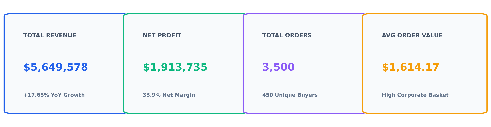
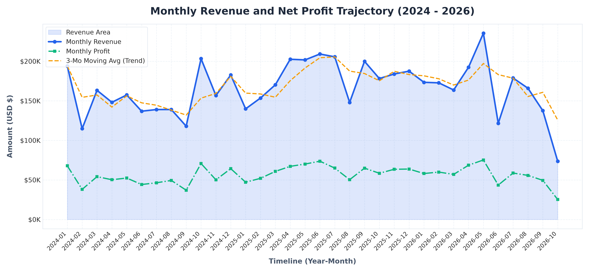
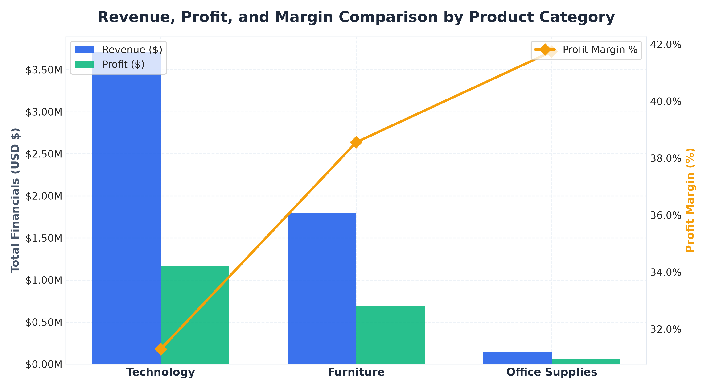
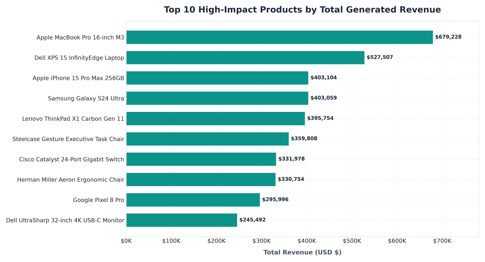
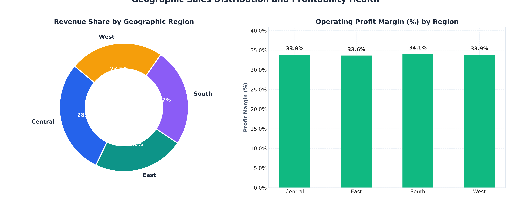

# 📊 Week 01: Sales & Revenue Analysis Dashboard

> **Data Analytics Internship — Project 01 of 04**  
> **Status:** Completed & Ready for Submission  
> **Tutorial Reference:** [YouTube Tutorial Guide](https://youtu.be/hhZ6EDiVboI?si=pcC3NkRkvTbOmbUK)

---

## 🎯 Project Overview & Objectives
The primary objective of this project is to build an enterprise-grade analytics dashboard system to monitor, analyze, and optimize multi-year sales revenue, profitability, product rankings, and regional performance. 

This repository implements both:
1. **Interactive Python Streamlit Dashboard** (`dashboard/streamlit_app.py`) with Plotly charts and live data slicing.
2. **Standalone Executive Web Dashboard** (`dashboard/web_dashboard/index.html`) using Vanilla JavaScript & Chart.js that runs natively in any web browser without needing local server setups.
3. **End-to-End Jupyter EDA Notebook** (`notebooks/01_sales_revenue_eda_and_kpis.ipynb`) with pre-executed code outputs and statistical figures.
4. **Data Engineering Ingestion Pipeline** (`src/data_pipeline.py`) supporting CSV, Excel, and SQLite databases with DAX-equivalent KPI measures.

---

## 📈 Executive KPI Snapshot
- **Total Net Revenue:** **$5,649,578.26**
- **Total Net Profit:** **$1,913,734.76**
- **Net Operating Profit Margin:** **33.87%**
- **Total Orders Fulfilled:** **3,500**
- **Unique Customers:** **450**
- **Average Order Value (AOV):** **$1,614.17**
- **YoY Top-Line Growth (FY24 → FY25):** **+17.65%**



---

## 🚀 Key Features Implemented

### 1. Multi-Format Data Ingestion
- **CSV Support:** Raw and processed transaction data loading with Pandas.
- **Excel Support:** Multi-sheet workbook parsing (`Sales_Transactions`, `Product_Catalog`, `Regional_Targets`).
- **SQLite Database Support:** Embedded relational SQL database export and query execution via Python SQLite3.

### 2. Multi-Dimensional Interactive Slicers & Filters
- **Temporal Slicer:** Year filtering (2024, 2025, 2026) and custom date ranges.
- **Geographic Slicer:** Territory drill-down (West, East, Central, South).
- **Product Hierarchy:** Category (Technology, Furniture, Office Supplies) and Subcategory filtering.
- **Customer Segmentation:** Consumer, Corporate, and Home Office splits.

### 3. Business Intelligence Visualizations
- **Revenue & Profit Trajectory:** Smooth monthly trendline with 3-month moving average overlay.
- **Category Profitability Matrix:** Dual-axis bar and margin percentage comparison.
- **Flagship SKU Rankings:** Top 10 best-selling products by dollar volume.
- **Territory Contribution:** Doughnut chart detailing regional market share.
- **Promotional Discount Elasticity:** Evaluating margin erosion across discount tiers.

---

## 🖼️ Visual Analytics Preview

| Monthly Revenue & Profit Trend | Category Profitability Breakdown |
| :---: | :---: |
|  |  |

| Top 10 Flagship Products | Regional Performance Distribution |
| :---: | :---: |
|  |  |

---

## 📂 Project Directory Structure

```text
Week 01 - Sales & Revenue Analysis Dashboard/
├── README.md                              # Comprehensive project documentation
├── requirements.txt                       # Project Python dependencies
├── data/
│   ├── raw/
│   │   ├── sales_data.csv                 # Raw 3,500 enterprise transactions
│   │   └── sales_data.xlsx                # Multi-sheet Excel workbook
│   └── processed/
│       ├── cleaned_sales_data.csv         # Cleaned, standardized dataset
│       ├── sales_database.sqlite          # Exported SQLite database
│       └── kpi_metrics_summary.json       # Precomputed executive KPI metrics
├── notebooks/
│   └── 01_sales_revenue_eda_and_kpis.ipynb # Pre-executed Jupyter Notebook
├── src/
│   ├── data_generator.py                  # Realistic sales dataset synthesizer
│   ├── data_pipeline.py                   # Multi-source ingestion & KPI calculations
│   └── generate_charts.py                 # High-resolution chart generator
├── dashboard/
│   ├── streamlit_app.py                   # Interactive Streamlit + Plotly application
│   └── web_dashboard/                     # Standalone Zero-Dependency Web Dashboard
│       ├── index.html                     # Executive Dashboard UI
│       ├── styles.css                     # Glassmorphism dark/light CSS
│       ├── sales_data.js                  # Preloaded transactions dataset
│       └── app.js                         # Dynamic Chart.js and slicer logic
└── reports/
    ├── Executive_Sales_Insights_Report.md # Full 8-section executive strategy report
    └── assets/                            # Rendered visual figures & KPI graphics
```

---

## ⚡ How to Run

### Option 1: Standalone Web Dashboard (Fastest - No Setup Needed!)
1. Navigate to: `Week 01 - Sales & Revenue Analysis Dashboard/dashboard/web_dashboard/`
2. Double-click `index.html` to open it in Chrome, Edge, Safari, or Firefox.
3. Enjoy interactive slicers, instant chart recalculations, live transaction search, CSV exports, and theme toggling!

### Option 2: Interactive Streamlit Dashboard
```bash
# 1. Install dependencies
pip install -r requirements.txt

# 2. Launch Streamlit
streamlit run "Week 01 - Sales & Revenue Analysis Dashboard/dashboard/streamlit_app.py"
```

### Option 3: Run the Data Pipeline & Generate Visuals
```bash
# Recompute KPIs and export SQLite database:
python "Week 01 - Sales & Revenue Analysis Dashboard/src/data_pipeline.py"

# Regenerate publication-quality charts:
python "Week 01 - Sales & Revenue Analysis Dashboard/src/generate_charts.py"
```

---

## 📋 Deliverables & Verification Checklist
- [x] Excel and CSV datasets generated and cleaned.
- [x] Multi-source ingestion pipeline (CSV, Excel, SQLite).
- [x] DAX-equivalent measures & business KPIs calculated.
- [x] Streamlit web application with interactive slicers and Plotly charts.
- [x] Standalone zero-dependency Web Dashboard with Chart.js.
- [x] Complete, fully executed Jupyter Notebook with outputs.
- [x] High-resolution charts saved for reporting.
- [x] Executive Sales & Revenue Insights Report completed.
