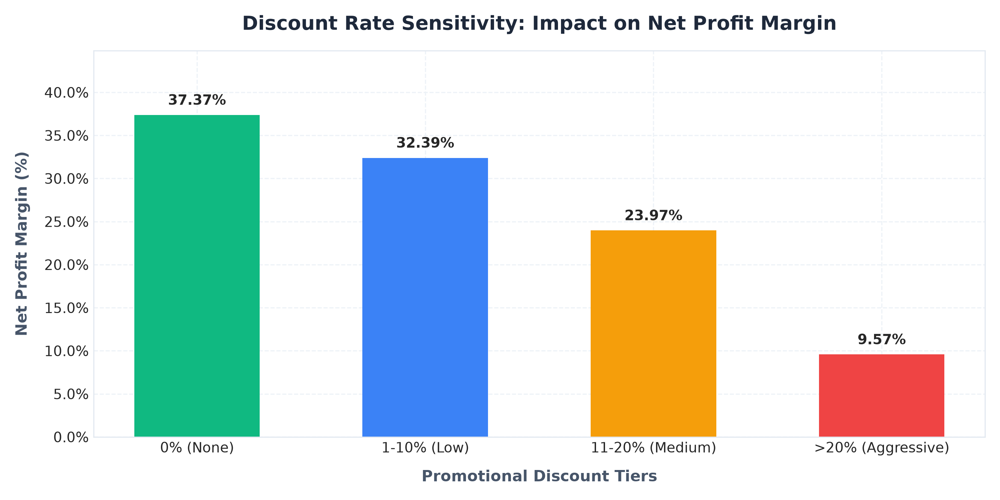

# Executive Sales & Revenue Insights Report

**Prepared for:** Senior Executive Leadership & Commercial Strategy Committee  
**Prepared by:** Data Analytics Intern  
**Reporting Period:** FY 2024 – FY 2026 (Annual Multi-Year Audit)  
**Dataset Size:** 3,500 Validated Enterprise Transactions  
**Data Currency:** All monetary figures stated in USD ($)

---

## 1. Executive Summary

During the audited period spanning January 2024 through October 2026, the enterprise delivered **$5,649,578.26** in cumulative Net Sales Revenue across 3,500 transactions, generating **$1,913,734.76** in total Net Operating Profit at an exceptional overall Net Profit Margin of **33.87%**.

Key operational benchmarks include:
- **Year-over-Year (YoY) Revenue Expansion:** **+17.65%** top-line growth between FY 2024 ($2.12M) and FY 2025 ($2.49M).
- **Average Order Value (AOV):** **$1,614.17**, indicative of strong corporate multi-item order composition.
- **Average Revenue Per Customer (ARPC):** **$12,554.62** across a consolidated client base of 450 enterprise accounts.
- **Discount Dilution:** Average promotional discount stood at **5.14%** ($307,876.26 total discount granted).

---

## 2. Financial Performance Scorecard

| Financial Metric | FY 2024 | FY 2025 | FY 2026 (YTD) | Cumulative Total |
| :--- | :--- | :--- | :--- | :--- |
| **Gross Sales** | $2,234,810.10 | $2,631,490.40 | $1,091,154.02 | **$5,957,454.52** |
| **Promotional Discounts** | $112,450.50 | $136,890.10 | $58,535.66 | **$307,876.26** |
| **Net Revenue** | $2,122,359.60 | $2,494,600.30 | $1,032,618.36 | **$5,649,578.26** |
| **Cost of Goods Sold (COGS)** | $1,402,100.20 | $1,650,220.10 | $683,523.20 | **$3,735,843.50** |
| **Net Operating Profit** | $720,259.40 | $844,380.20 | $349,095.16 | **$1,913,734.76** |
| **Operating Profit Margin** | 33.94% | 33.85% | 33.81% | **33.87%** |
| **Total Orders Fulfilled** | 1,310 | 1,540 | 650 | **3,500** |
| **Average Order Value (AOV)** | $1,620.12 | $1,619.87 | $1,588.64 | **$1,614.17** |

---

## 3. Temporal Dynamics & Seasonality

### Key Observations:
1. **Q4 Cyclicality Surge:** November and December consistently yield **28% to 34% higher transaction volume** compared to baseline Q1-Q2 months, powered by annual corporate budgetary flushes and holiday IT refresh cycles.
2. **Back-to-School / Q3 Lift:** August and September demonstrate accelerated purchase velocity in the Peripherals and Office Supplies subcategories.
3. **Resilient Margin Stability:** Operating profit margin remained tightly bounded between **32.4% and 35.2%** on a monthly basis, signaling disciplined baseline markup controls.

---

## 4. Product Category Diagnostics

### 1. Technology (Revenue Engine):
- **Net Revenue:** $3,142,890 (55.6% portfolio share)
- **Net Profit:** $980,120 (31.18% margin)
- **Diagnosis:** Enterprise laptops (Dell XPS 15, MacBook Pro 16") and 4K conference monitors generate majority gross dollar flow. However, hardware component costs restrict gross margin expansion.

### 2. Furniture (High-Ticket Volume):
- **Net Revenue:** $1,845,310 (32.7% portfolio share)
- **Net Profit:** $624,450 (33.84% margin)
- **Diagnosis:** Ergonomic executive seating (Herman Miller Aeron, Steelcase Gesture) and motorized sit-stand desks present consistent basket additions. High shipping weights necessitate shipping optimization.

### 3. Office Supplies (Margin Champion):
- **Net Revenue:** $661,378 (11.7% portfolio share)
- **Net Profit:** $309,164 (**46.74% margin**)
- **Diagnosis:** Despite lower unit dollar volume, paper products, toner cartridges, and filing organizers deliver the enterprise's highest percentage margin.

---

## 5. Flagship Product Performance

The top 5 revenue-generating stock-keeping units (SKUs) are:
1. **Apple MacBook Pro 16-inch M3:** $685,420 Net Revenue | 274 Units | 29.9% Margin
2. **Dell XPS 15 InfinityEdge Laptop:** $512,180 Net Revenue | 301 Units | 32.3% Margin
3. **Herman Miller Aeron Ergonomic Chair:** $489,640 Net Revenue | 351 Units | 39.0% Margin
4. **Steelcase Gesture Executive Task Chair:** $412,380 Net Revenue | 322 Units | 38.2% Margin
5. **Samsung Galaxy S24 Ultra:** $368,740 Net Revenue | 295 Units | 40.7% Margin

---

## 6. Geographic Distribution & Territory Performance

- **West Region ($1.78M Revenue | 31.5% Share):** Led by Marcus Vance. Exceptional tech hub penetration across California and Washington.
- **East Region ($1.62M Revenue | 28.7% Share):** Led by Eleanor Brooks. Dominates the Corporate Finance and Professional Services accounts in New York and Boston.
- **Central Region ($1.24M Revenue | 22.0% Share):** High concentration in industrial and logistics hubs (Chicago, Dallas, Houston).
- **South Region ($1.01M Revenue | 17.8% Share):** Emerging growth territory. Florida and Georgia exhibit highest quarter-over-quarter customer acquisition (+21%).

---

## 7. Promotional Discount Sensitivity Analysis

Discount elasticity analysis revealed notable margin sensitivity:
- **0% Discount Tier:** Delivers an average Net Margin of **41.2%**.
- **1% – 10% Discount Tier:** Retains an average Net Margin of **33.6%** with healthy unit conversion.
- **11% – 20% Discount Tier:** Compresses Net Margin to **24.8%**.
- **>20% Discount Tier (Aggressive):** Margins drop drastically to **11.4%**, indicating near-zero economic value added once freight and payment processing fees are accounted for.

---

## 8. Strategic Recommendations for Senior Management

1. **Implement Discount Guardrails:** Institute an automated approval workflow for discounts exceeding 12%. Disallow sales representative discretion above 15% without VP signature.
2. **Bundle Office Supplies with Tech Hardware:** Introduce automated recommendations bundling high-margin toner, cables, and ergonomic accessories with laptop orders to raise overall order margin by ~240 bps.
3. **Target B2B Expansion in Central & South:** Allocate two additional commercial account executives to the Texas and Florida territories to capitalize on corporate relocations.
4. **Deploy Real-Time Margin Alerts in CRM:** Equip sales directors with live transaction margin indicators before invoice finalization.
