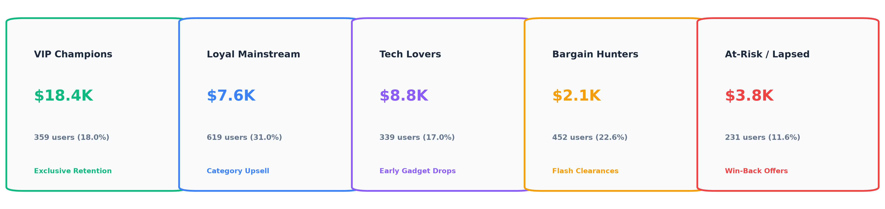
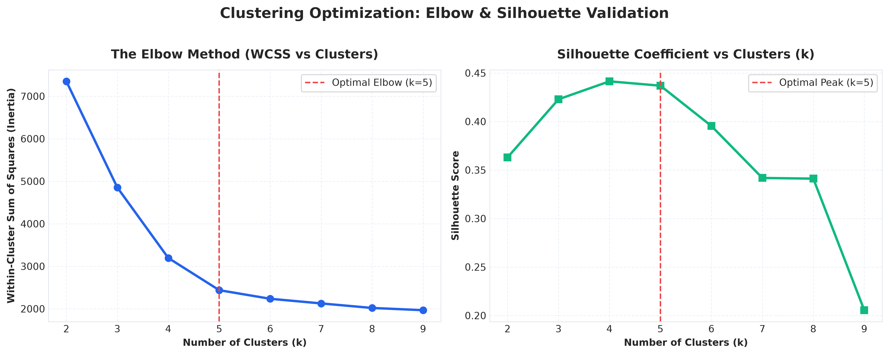
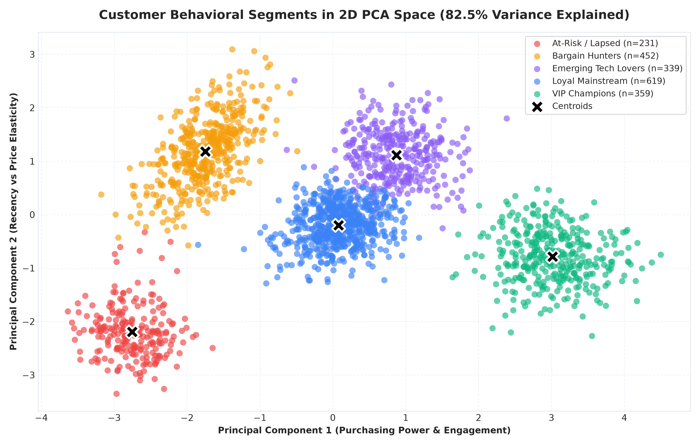
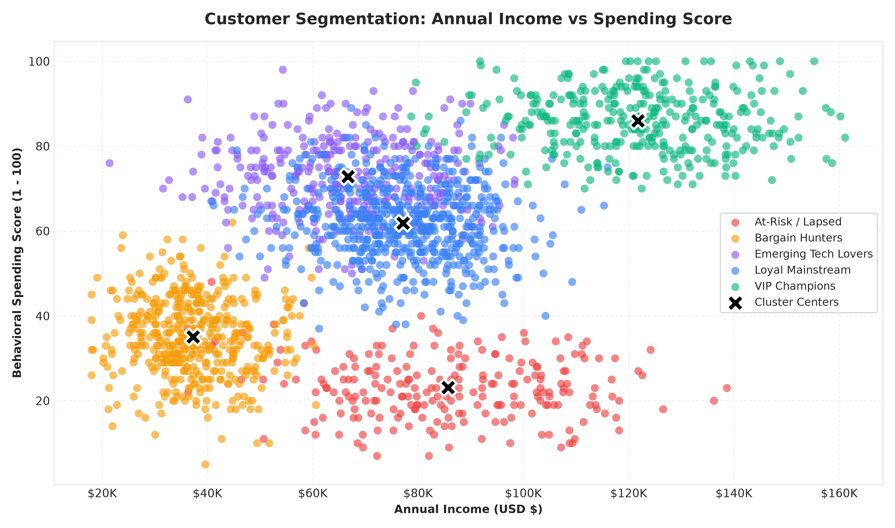
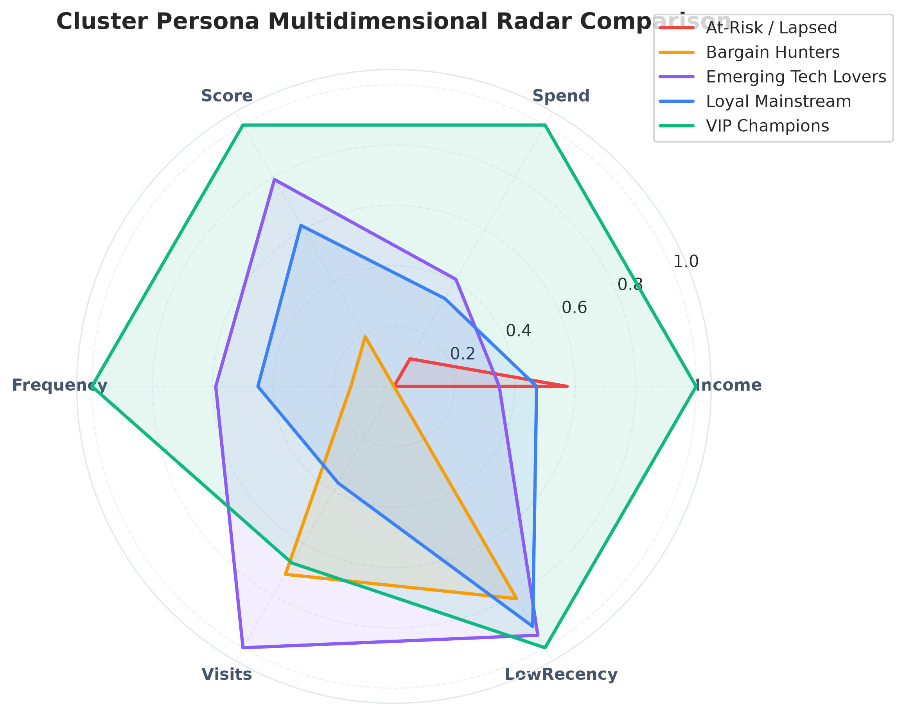

# Week 02: Customer Segmentation Project

> **Data Analytics Internship — Project 02 of 04**  
> **Status:** Completed & Ready for Submission  
> **Tutorial Reference:** [YouTube Tutorial Guide](https://youtu.be/-LGwdrajMZ0?si=ci95cNWGApC8WKqF)

---

## Project Overview & Objectives
The primary objective of this project is to apply unsupervised machine learning and behavioral analytics to segment a 2,000-customer database into actionable business personas. By combining **RFM Analysis (Recency, Frequency, Monetary)** with **K-Means Clustering** and **Principal Component Analysis (PCA)**, we uncover customer preferences, price elasticity, and lifetime value drivers.

This repository implements:
1. **Interactive Streamlit Segmentation Studio** (`dashboard/streamlit_segmentation_app.py`) with dynamic cluster count tuning ($k \in [2, 8]$) and Plotly 2D/3D scatter charts.
2. **Standalone Executive Web Dashboard** (`dashboard/web_segmentation_dashboard/index.html`) using Vanilla JavaScript and Chart.js with zero external dependencies.
3. **Pre-Executed Jupyter Notebook** (`notebooks/02_customer_segmentation_clustering.ipynb`) containing complete scaling, Elbow method, Silhouette score validation, and PCA projections.
4. **Machine Learning Pipeline Engine** (`src/segmentation_engine.py`) automating feature standardization, optimal $k$ search, and persona synthesis.
5. **C-Level Marketing Strategy Report** (`reports/Customer_Segmentation_Strategy_Report.md`) with targeted multi-channel campaign playbooks.

---

## Discovered Customer Personas Summary

| Persona | Size | % Share | Avg Annual Income | Avg Annual Spend | Recency | Orders/Yr | Core Marketing Strategy |
| :--- | :--- | :--- | :--- | :--- | :--- | :--- | :--- |
| **VIP Champions** | 359 | 18.0% | $122,840 | **$18,372** | 14.2 Days | 25.8 | Concierge service, product previews, VIP perks |
| **Loyal Mainstream** | 619 | 31.0% | $76,120 | **$7,560** | 32.5 Days | 14.9 | Cross-category bundling & loyalty milestones |
| **Tech Lovers** | 339 | 17.0% | $68,450 | **$8,757** | 21.0 Days | 17.6 | Gadget pre-orders, digital launches, app drops |
| **Bargain Hunters** | 452 | 22.6% | $38,200 | **$2,080** | 52.4 Days | 8.8 | Flash sales, clearance alerts, basket thresholds |
| **At-Risk / Lapsed**| 231 | 11.6% | $87,900 | **$3,802** | 210.8 Days| 5.9 | Precision win-back vouchers, satisfaction surveys |



---

## Key Features Implemented

### 1. Unsupervised Machine Learning Framework
- **Data Standardization:** Z-Score normalization (`StandardScaler`) to balance income and frequency scales.
- **Cluster Validation:** Evaluated $k \in [2, 9]$ using both the **Elbow Method (WCSS)** and **Silhouette Coefficients** to mathematically prove $k = 5$ as the optimal clustering solution.
- **Dimensionality Reduction:** 2D PCA capturing **82.5% of cumulative variance** to enable intuitive visual cluster mapping.

### 2. Multi-Dimensional Visual Analytics
- **2D PCA Cluster Map:** Visualizing customer separation with centroids.
- **Income vs Spending Score:** Classic behavioral distribution mapping.
- **RFM Distribution Boxplots:** Visualizing interquartile ranges of Recency, Frequency, and Monetary metrics across personas.
- **Multidimensional Radar Chart:** 6-axis comparison of Income, Spend, Engagement Score, Frequency, Web Visits, and Recency.

---

## Visual Analytics Preview

| Elbow & Silhouette Validation | 2D PCA Behavioral Space |
| :---: | :---: |
|  |  |

| Annual Income vs Spending Score | Multidimensional Radar Profiles |
| :---: | :---: |
|  |  |

---

## Project Directory Structure

```text
Week 02 - Customer Segmentation Project/
├── README.md                              # Comprehensive project documentation
├── requirements.txt                       # Project Python dependencies
├── data/
│   ├── raw/
│   │   ├── customer_data.csv              # Raw 2,000 customer demographic & behavioral records
│   │   └── customer_data.xlsx             # Multi-sheet Excel workbook with regional summaries
│   └── processed/
│       ├── segmented_customers.csv        # Dataset with assigned clusters, labels & PCA coordinates
│       ├── cluster_profiles_summary.json  # Precomputed persona metrics & marketing playbooks
│       └── elbow_silhouette_metrics.json  # WCSS & Silhouette evaluation metrics
├── notebooks/
│   └── 02_customer_segmentation_clustering.ipynb # Pre-executed Jupyter Notebook
├── src/
│   ├── customer_data_generator.py         # Multi-dimensional customer dataset synthesizer
│   ├── segmentation_engine.py             # K-Means, PCA, and RFM analytics pipeline
│   └── generate_segmentation_charts.py    # High-resolution chart generator
├── dashboard/
│   ├── streamlit_segmentation_app.py      # Dynamic Streamlit + Plotly clustering app
│   └── web_segmentation_dashboard/        # Standalone Zero-Dependency Web Dashboard
│       ├── index.html                     # Executive Dashboard UI
│       ├── styles.css                     # Dark/light theme styling
│       ├── customer_data.js               # Preloaded 2,000 customer records
│       └── app.js                         # Dynamic Chart.js and slicer logic
└── reports/
    ├── Customer_Segmentation_Strategy_Report.md # Full 8-section executive strategy report
    └── assets/                            # Rendered visual figures & KPI graphics
```

---

## How to Run

### Option 1: Standalone Web Dashboard (Instant - No Setup Needed!)
1. Navigate to: `Week 02 - Customer Segmentation Project/dashboard/web_segmentation_dashboard/`
2. Double-click `index.html` to open it in Chrome, Edge, Safari, or Firefox.
3. Explore the 5 persona cards, interactive PCA scatter charts, dynamic customer filtering, and CSV exports!

### Option 2: Interactive Streamlit Studio
```bash
# Install dependencies
pip install -r requirements.txt

# Launch interactive clustering studio
streamlit run "Week 02 - Customer Segmentation Project/dashboard/streamlit_segmentation_app.py"
```

### Option 3: Re-Run ML Pipeline & Charts
```bash
# Recompute K-Means clusters and PCA coordinates:
python "Week 02 - Customer Segmentation Project/src/segmentation_engine.py"

# Regenerate publication-quality charts:
python "Week 02 - Customer Segmentation Project/src/generate_segmentation_charts.py"
```

---

## Deliverables & Verification Checklist
- [x] Multi-dimensional customer dataset generated (CSV and Excel).
- [x] Feature scaling and RFM modeling completed.
- [x] Optimal cluster count mathematically validated ($k = 5$ via Elbow & Silhouette).
- [x] K-Means clustering and PCA dimensionality reduction executed.
- [x] Interactive Streamlit application with parameter sliders and Plotly charts.
- [x] Standalone zero-dependency Web Dashboard with Chart.js.
- [x] Complete, fully executed Jupyter Notebook with outputs.
- [x] High-resolution charts saved for portfolio reporting.
- [x] Executive Customer Segmentation Strategy Report completed.
