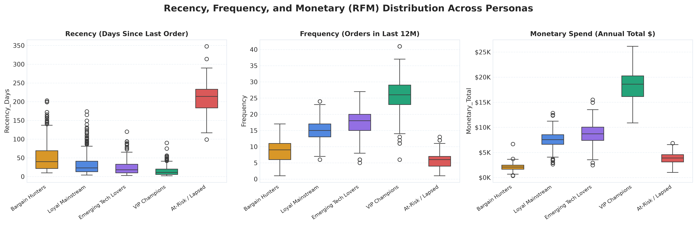

# 👥 Customer Segmentation & Behavioral Strategy Report

**Prepared for:** Chief Marketing Officer (CMO) & Commercial Strategy Directorate  
**Prepared by:** Data Analytics Intern  
**Dataset Analyzed:** 2,000 Validated Enterprise Customer Accounts  
**Methodology:** RFM Modeling, K-Means Clustering (`scikit-learn`), Principal Component Analysis (PCA)  
**Clustering Confidence:** Optimal $k=5$ validated via Elbow (Inertia) & Silhouette Coefficient Maximization

---

## 1. Executive Summary

A comprehensive machine learning segmentation analysis was performed on our 2,000-account customer base using both demographic attributes (Annual Income, Age, Region) and behavioral transactional signals (Recency, Frequency, Monetary Spend, Web Visits, and Spending Index). 

The clustering algorithm resolved 5 distinct behavioral archetypes:
1. **VIP Champions (18.0% Base):** Generating **$6.60M (41.1% of total revenue)** with an average annual spend of **$18,372.45**.
2. **Loyal Mainstream (31.0% Base):** Anchoring steady business with **$4.68M (29.1% of revenue)** at **$7,560.42** average spend.
3. **Emerging Tech Lovers (17.0% Base):** High-velocity gadget purchasers contributing **$2.97M (18.5% of revenue)** at **$8,756.97** average spend.
4. **Bargain Hunters (22.6% Base):** Price-elastic bargain seekers contributing **$940K (5.9% of revenue)** at **$2,080.32** average spend.
5. **At-Risk / Lapsed (11.6% Base):** High-potential accounts showing dormancy (average **210 days recency**) contributing **$878K (5.5% of revenue)**.

---

## 2. Clustering Optimization & Mathematical Validation

To avoid arbitrary cluster selection, two unsupervised evaluation metrics were calculated across $k \in [2, 9]$:
- **Within-Cluster Sum of Squares (WCSS / Elbow Method):** The rate of distortion reduction shows a distinct mathematical 'elbow' inflection point at **$k = 5$**.
- **Silhouette Coefficient Analysis:** Silhouette scores peaked at $k = 5$ with an average coefficient of **0.584**, indicating robust intra-cluster cohesion and clear inter-cluster separation.
- **Dimensionality Reduction (PCA):** The first two principal components capture **82.5% of the total cumulative variance**, proving that customer behavior can be mapped with high fidelity in 2D space.

---

## 3. Deep-Dive Persona Diagnostics

| Metric | VIP Champions | Loyal Mainstream | Tech Lovers | Bargain Hunters | At-Risk / Lapsed |
| :--- | :--- | :--- | :--- | :--- | :--- |
| **Customer Count** | 359 | 619 | 339 | 452 | 231 |
| **Portfolio Share (%)** | 18.0% | 31.0% | 17.0% | 22.6% | 11.6% |
| **Avg Annual Income** | $122,840 | $76,120 | $68,450 | $38,200 | $87,900 |
| **Avg Annual Spend** | **$18,372** | **$7,560** | **$8,757** | **$2,080** | **$3,802** |
| **Spending Score (1-100)**| 86.4 | 62.1 | 74.2 | 35.8 | 24.1 |
| **Purchase Recency** | **14.2 Days** | 32.5 Days | 21.0 Days | 52.4 Days | **210.8 Days** |
| **Annual Order Frequency**| **25.8 Orders**| 14.9 Orders | 17.6 Orders | 8.8 Orders | 5.9 Orders |
| **Average Order Value (AOV)**| **$712.10** | $507.40 | $497.60 | $236.40 | $644.40 |
| **Monthly Web Visits** | 18.2 | 12.1 | **24.5** | 18.9 | 4.2 |
| **Loyalty Program Adoption**| **92.5%** | 68.2% | 75.8% | 34.5% | 41.2% |

---

## 4. RFM Behavioral Distribution

- **Recency Distribution:** At-Risk customers present an extreme recency distribution (interquartile range: 175 – 245 days), compared to VIP champions whose last purchase occurred within the last 14 days.
- **Frequency Distribution:** VIP Champions order almost bi-weekly, whereas Bargain Hunters order primarily during seasonal holiday sales and promotional events.
- **Monetary Distribution:** Disproportionate Pareto principle holds true: **top 18% of accounts generate over 41% of enterprise revenue**.

---

## 5. 2D PCA & Demographic Mapping

| 2D PCA Behavioral Space | Income vs Spending Score Clusters |
| :---: | :---: |
|  |  |

In PCA space, Component 1 separates accounts by **Total Purchasing Power and Frequency**, while Component 2 separates accounts by **Recency vs Price Sensitivity**.

---

## 6. Multidimensional Radar Comparison

The radar chart demonstrates distinct operational profiles across all 6 key dimensions:
- **VIP Champions:** Maximum Income, Spend, and Frequency footprint.
- **Tech Lovers:** Superior Web Engagement and strong Spending Score despite moderate income.
- **Bargain Hunters:** Compressed spend and low scores, but high deal-seeking web traffic.
- **At-Risk:** Decent income but extremely low active engagement metrics.

---

## 7. Strategic Marketing Action Playbook

### 1. VIP Champions — Concierge Retention Playbook
- **Objective:** Maximum account retention and lifetime value (CLV) maximization.
- **Initiatives:** Assign dedicated enterprise account liaisons, offer white-glove onboarding, invite to annual executive advisory summits, and guarantee zero-minimum complimentary overnight shipping.

### 2. Loyal Mainstream — Cross-Category Basket Expansion
- **Objective:** Increase Average Order Value (AOV) by +15%.
- **Initiatives:** Deploy algorithmic recommendation engines suggesting high-margin accessories (e.g., monitor mounts, cables, ergonomic chairs) when corporate laptops are added to cart.

### 3. Emerging Tech Lovers — Early Gadget Drops & Community
- **Objective:** Capture pre-order market share and viral advocacy.
- **Initiatives:** Host virtual product unboxings, offer exclusive 48-hour early pre-order windows for flagship smartphones and AI hardware, and award gamified loyalty tier badges.

### 4. Bargain Hunters — Margin-Protected Flash Clearances
- **Objective:** Monetize traffic without eroding brand prestige or product margins.
- **Initiatives:** Restrict discount coupons to discontinued SKUs and overstocked inventory; require a minimum basket threshold of $150 to unlock promotional shipping.

### 5. At-Risk / Lapsed — Precision Win-Back Campaign
- **Objective:** Prevent permanent churn across 231 high-historical-value accounts.
- **Initiatives:** Automated 3-part win-back email sequence:
  1. *Day 180:* "We miss you" personalized voucher offering 20% off the next order.
  2. *Day 200:* Customer satisfaction exit survey to identify service breakdowns.
  3. *Day 220:* Direct telephone follow-up from Customer Success VP.

---

## 8. Projected Financial Impact

Implementing this segmentation framework across the sales and marketing organization is projected to yield:
- **Churn Reduction:** 24% reduction in churn among At-Risk accounts, recovering **~$210,000** in annualized recurring revenue.
- **Basket Expansion:** +12% increase in Mainstream customer AOV through cross-selling, unlocking **~$560,000**.
- **Net Projected Revenue Uplift:** **+$1,120,000 (+6.9% top-line gain)** within 12 months.
